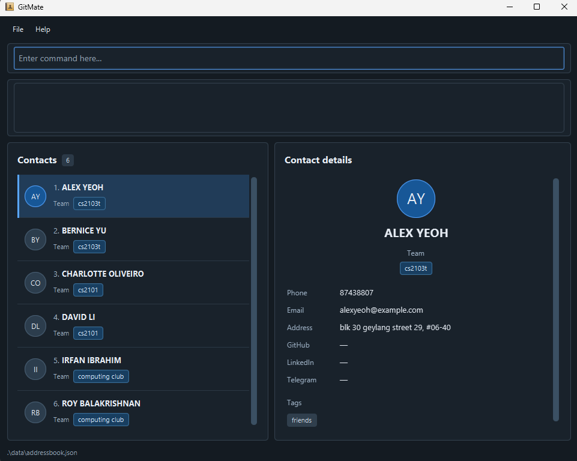

# AB-3 User Guide

AddressBook Level 3 (AB3) is a **desktop application for managing contacts, optimized for use through a Command Line Interface (CLI)** while retaining the benefits of a Graphical User Interface (GUI). If you type quickly, AB3 can help you manage contacts faster than traditional GUI applications.

<!-- * Table of Contents -->
<page-nav-print />

--------------------------------------------------------------------------------------------------------------------

## Quick start

1. Ensure that Java `25` or later is installed on your computer.<br>
   **Mac users:** Ensure you have the precise JDK version prescribed [here](https://se-education.org/guides/tutorials/javaInstallationMac.html).

1. Download the latest `.jar` file from [here](https://github.com/se-edu/addressbook-level3/releases).

1. Copy the file to the folder you want to use as the _home folder_ for your AddressBook.

1. Open a terminal, `cd` to the folder containing the JAR file, and run `java -jar addressbook.jar`.<br>
   A GUI similar to the one below should appear in a few seconds. Note how the app contains some sample data.<br>
   

1. Type a command in the command box and press Enter to execute it. For example, type **`help`** and press Enter to open the help window.<br>
   Some example commands you can try:

   * `list` : Lists all contacts.

   * `add n/John Doe p/98765432 e/johnd@example.com a/John street, block 123, #01-01` : Adds a contact named `John Doe` to the Address Book.

   * `delete 3` : Deletes the 3rd contact shown in the current list.

   * `clear` : Deletes all contacts.

   * `exit` : Exits the app.

1. Refer to the [Features](#features) section below for details of each command.

--------------------------------------------------------------------------------------------------------------------

## Features

<box type="info" seamless>

**Notes about the command format:**<br>

* Words in `UPPER_CASE` are the parameters to be supplied by the user.<br>
  For example, in `add n/NAME`, replace `NAME` with a value such as `John Doe`.

* Items in square brackets are optional.<br>
  For example, `n/NAME [t/TAG]` can be used as `n/John Doe t/friend` or as `n/John Doe`.

* Items followed by `...` can appear zero or more times.<br>
  For example, `[t/TAG]... ` may be omitted, or written as `t/friend` or `t/friend t/family`.

* Parameters can be in any order.<br>
  For example, if the command specifies `n/NAME p/PHONE_NUMBER`, `p/PHONE_NUMBER n/NAME` is also acceptable.

* Extraneous parameters for commands that take no parameters, such as `help`, `list`, `exit`, and `clear`, are ignored.<br>
  For example, `help 123` is interpreted as `help`.

* If you are using a PDF version of this document, be careful when copying and pasting commands that span multiple lines as space characters surrounding line-breaks may be omitted when copied over to the application.
</box>

### Viewing help: `help`

Shows a message explaining how to access the help page.


Format: `help`


### Adding a person: `add`

Adds a person to the address book.

Format: `add n/NAME p/PHONE_NUMBER e/EMAIL a/ADDRESS [t/TAG]... `

<box type="tip" seamless>

**Tip:** A person can have any number of tags, including zero.
</box>

Examples:
* `add n/John Doe p/98765432 e/johnd@example.com a/John street, block 123, #01-01`
* `add n/Betsy Crowe t/friend e/betsycrowe@example.com a/Newgate Prison p/1234567 t/criminal`

### Listing all persons: `list`

Shows a list of all persons in the address book.
* Empty list while using list command outputs "Your contact list is empty."; 

Format: `list`

### Editing a person: `edit`

Edits an existing person in the address book.

Format: `edit INDEX [n/NAME] [p/PHONE] [e/EMAIL] [a/ADDRESS] [t/TAG]... `

* Edits the person at the specified `INDEX`. The index refers to the index number shown in the displayed person list. The index **must be a positive integer** 1, 2, 3, ...
* At least one of the optional fields must be provided.
* Existing values will be updated to the input values.
* When editing tags, all of the person's existing tags are removed; adding tags is not cumulative.
* To remove all of a person's tags, enter `t/` without a tag after it.

Examples:
*  `edit 1 p/91234567 e/johndoe@example.com` Edits the phone number and email address of the 1st person to be `91234567` and `johndoe@example.com` respectively.
*  `edit 2 n/Betsy Crower t/` Edits the name of the 2nd person to be `Betsy Crower` and clears all existing tags.

### Locating persons by name: `find`

Finds persons whose names contain any of the given keywords.

Format: `find KEYWORD [MORE_KEYWORDS]`

* The search is case-insensitive; for example, `hans` matches `Hans`.
* Keyword order does not matter; for example, `Hans Bo` matches `Bo Hans`.
* The search considers only names.
* Only full words match; for example, `Han` does not match `Hans`.
* Persons matching at least one keyword are returned (an `OR` search); for example, `Hans Bo` returns `Hans Gruber` and `Bo Yang`.

Examples:
* `find John` returns `john` and `John Doe`
* `find alex david` returns `Alex Yeoh`, `David Li`<br>
  

### Pinning a contact: `pin`

Keeps an important contact above unpinned contacts, with a star beside its name.

Format: `pin [n/NAME] [p/PHONE_NUMBER] [a/ADDRESS] [e/EMAIL] [gh/GITHUB] [li/LINKEDIN] [tg/TELEGRAM] [g/GROUP]... [t/TAG]...`

* Provide at least one field. All supplied values must match in full, ignoring letter case except for GitHub usernames (`gh/`).
* If several contacts match, GitMate displays them and requests more details. No contact is pinned unless exactly one matches. An already-pinned contact produces an error.
* Pinned contacts stay in the order they were added, above unpinned contacts.
* Searches all contacts without clearing the current search after success. Use `list` to see a pinned contact hidden by the search.
* Pins are saved automatically and retained after editing or restarting. There is no `unpin` command.

Examples:

* `pin p/98765432` pins the contact with phone number `98765432`.
* `pin n/John Doe p/98765432` pins the contact matching both the full name and phone number.

### Deleting a person: `delete`

Deletes the specified person from the address book.

Format: `delete INDEX`

* Deletes the person at the specified `INDEX`.
* The index refers to the index number shown in the displayed person list.
* The index **must be a positive integer** 1, 2, 3, ...

Examples:
* `list` followed by `delete 2` deletes the 2nd person in the address book.
* `find Betsy` followed by `delete 1` deletes the 1st person in the results of the `find` command.

### Undoing previous ccommand: `undo`

Restores the address book to the state before the most recent data-changing
command.

Format: `undo`

* The undo command can undo data-changing commands such as add, delete, edit, and clear.
* It does not undo view-only commands such as find, list, or sort.

### Clearing all entries: `clear`

Clears all entries from the address book.

Format: `clear`

### Exiting the program: `exit`

Exits the program.

Format: `exit`

### Saving the data

AddressBook automatically saves data after every command. You do not need to save manually.

### Editing the data file

AddressBook data is saved automatically as a JSON file `[JAR file location]/data/addressbook.json`. Advanced users are welcome to update data directly by editing that data file.

<box type="warning" seamless>

**Caution:**
If your changes make the data file invalid, AddressBook starts with an empty address book at the next run. The invalid file remains on disk until you run a command (AddressBook saves after every command). Still, we recommend backing up the file before editing it.<br>
Furthermore, certain edits can cause the AddressBook to behave in unexpected ways (e.g., if a value entered is outside of the acceptable range). Therefore, edit the data file only if you are confident that you can update it correctly.
</box>

### Archiving data files `[coming in v2.0]`

_Details coming soon ..._

--------------------------------------------------------------------------------------------------------------------

## FAQ

**Q**: How do I transfer my data to another computer?<br>
**A**: Install the app on the other computer and overwrite the data file it creates with the data file from your previous AddressBook home folder.

--------------------------------------------------------------------------------------------------------------------

## Known issues

1. **When using multiple screens**, if you move the application to a secondary screen, and later switch to using only the primary screen, the GUI will open off-screen. The remedy is to delete the `preferences.json` file created by the application before running the application again.
2. **If you minimize the Help Window** and then run the `help` command (or use the `Help` menu, or the keyboard shortcut `F1`) again, the original Help Window will remain minimized, and no new Help Window will appear. The remedy is to manually restore the minimized Help Window.

--------------------------------------------------------------------------------------------------------------------

## Sorting the current list: `sort`

Format: `sort name|group|tag [asc|desc] [cont|none]`. Defaults to `asc` and `none`.

* `sort name asc` sorts names alphabetically, ignoring case; `sort name desc` reverses the order.
* `sort group` sorts by each contact's alphabetically first group, breaking ties by name.
  `sort group desc` reverses group order while keeping names within a group alphabetical.
* `sort tag` uses each contact's alphabetically first tag, ignoring case and breaking ties by name.
  `sort tag desc` reverses tag order while keeping names within a tag alphabetical.
* Pinned contacts stay first. Sorting applies separately within the pinned and unpinned sections;
  contacts without groups or tags appear last within their section when sorting by that field, in either direction.
* Sorting preserves the current search filter. For example, run `find g/t09`, then `sort name`.
* Sorting remains active for subsequent searches, additions, edits, and `list` in the current session.
  Edited contacts move to their new sorted position. Sorting does not change saved contact order or create an undo step.
* Add `cont` to save the sort preference on normal application exit and restore it on the next launch.
  For example, `sort name asc cont` or `sort tag cont`. The current search filter is not saved.
* Omitting `cont`, or specifying `none`, clears any previously saved sort preference on normal exit.
  Sorting still stays active during the current session; the next launch uses pinned-first stored order.
  For example, `sort group desc none`. Forced termination before saving may lose preference changes.

## Importing contacts: `import`

Format: `import FILE_PATH`, for example `import data/contacts-20261025-042535.csv`.
Use a UTF-8 CSV file with the header exported by GitMate, in the same order:

```csv
name,phone,email,address,groups,github,linkedin,telegram,tags,pinned
```

* The entire argument is the path. Spaces are allowed without surrounding quotes.
  Relative paths start from the application's working directory; absolute paths are also accepted.
* Import adds contacts without overwriting existing contacts. A phone number already in the address book,
  or repeated in the file, rejects the whole batch. Invalid records also reject the whole batch.
  Error record numbers count the header as record 1; quoted line breaks do not start new records.
* Empty optional fields are allowed. Use semicolons between groups or tags and `true` or `false` for pinned status.
  An empty file or a header-only file imports nothing and reports an error.
* Pinned status is preserved. The current filter, active sort, and saved sort preference remain active.
  Use `list` if imported contacts are hidden by the current filter.
* One `undo` reverses the entire successful import. Contacts are saved through the normal address-book save path.
  As with other data-changing commands, a disk-save failure can leave changes in memory; validation failures do not.
* Export compatibility limitations: leading spreadsheet-protection apostrophes are preserved, because they cannot
  be distinguished from literal apostrophes. Semicolons in the groups column always separate groups, so a group
  name containing a semicolon cannot be restored unambiguously from the current export format.

## Command summary

Action     | Format, Examples
-----------|----------------------------------------------------------------------------------------------------------------------------------------------------------------------
**Add**    | `add n/NAME p/PHONE_NUMBER e/EMAIL a/ADDRESS [t/TAG]... ` <br> e.g., `add n/James Ho p/22224444 e/jamesho@example.com a/123, Clementi Rd, 1234665 t/friend t/colleague`
**Clear**  | `clear`
**Delete** | `delete INDEX`<br> e.g., `delete 3`
**Edit**   | `edit INDEX [n/NAME] [p/PHONE_NUMBER] [e/EMAIL] [a/ADDRESS] [t/TAG]... `<br> e.g.,`edit 2 n/James Lee e/jameslee@example.com`
**Find**   | `find KEYWORD [MORE_KEYWORDS]`<br> e.g., `find James Jake`
**List**   | `list`
**Import** | `import FILE_PATH`<br> e.g., `import data/contacts.csv`
**Sort**   | `sort name\|group\|tag [asc\|desc] [cont\|none]`<br> e.g., `sort name asc cont`, `sort tag`
**Pin**    | `pin [n/NAME] [p/PHONE_NUMBER] [a/ADDRESS] [e/EMAIL] [gh/GITHUB] [li/LINKEDIN] [tg/TELEGRAM] [g/GROUP]... [t/TAG]...` (at least one field)<br> e.g., `pin p/98765432`
**Help**   | `help`
